# CashDriver

[English](README.md) · **Español** · [Українська](README.uk.md)

### Cobros en efectivo para conductores: cambio, propinas, historial e informes mensuales en una sola app.

**CashDriver** es una aplicación Android para conductores de taxi y servicios de transporte. Ayuda a calcular el cambio, registrar propinas y consultar los cobros en efectivo por día, semana o mes. Funciona **sin conexión**, sin registro ni un servidor obligatorio.

Selecciona una plataforma → introduce el importe del viaje y el efectivo recibido → comprueba el cambio → confirma el cobro. La operación guardada aparece automáticamente en el historial y en los resúmenes.

> Plataforma compatible: **Android 7.0+**. Idiomas de la app: **Español / English**. Moneda: **EUR**. Versión actual: **1.1.0**. iOS no es compatible actualmente; los archivos APK no se pueden instalar en un iPhone.

## Qué puedes hacer con CashDriver

- **Calcular el cambio al instante.** Introduce decimales con coma o punto, utiliza importes rápidos y la opción «Exacto» para pagos sin cambio.
- **Registrar las propinas por separado.** Introduce una cantidad concreta o deja todo el cambio como propina.
- **Consultar el historial de cobros.** Busca un período con el calendario, filtra por plataforma, consulta detalles, edita y elimina operaciones individuales con una oportunidad de deshacer.
- **Entender los totales.** Consulta el importe de los viajes, las propinas, el efectivo retenido, el número de operaciones, el importe medio por viaje y los totales por plataforma.
- **Exportar y guardar tus datos.** Guarda un mes como **informe PDF** o **archivo CSV** para tu gestor, crea una **copia de seguridad** de todas las operaciones y restáurala cuando la necesites (Ajustes → Datos).
- **Adaptar la app a tu trabajo.** Elige Uber, Cabify, Bolt y Taxi; tema claro, oscuro o automático; sonido y vibración independientes con un botón de prueba.

**Ejemplo:** el viaje cuesta **20 €**, el cliente entrega **50 €** y la propina es de **5 €**. Hay que devolver **25 €**; el efectivo retenido es de **25 €**: el importe del viaje más la propina.

Las plataformas son etiquetas seleccionadas manualmente. CashDriver no se conecta a sus cuentas. Los totales de efectivo no incluyen gastos ni comisiones y no representan un cálculo de beneficios.

## Capturas de pantalla

Capturas reales de un emulador Android (versión 1.1.0) con datos sintéticos de demostración y la interfaz en español. No se utilizaron operaciones personales.

| Pantalla                                                                                                       | Tema claro                                                                                                                         | Tema oscuro                                                                                                                        |
| -------------------------------------------------------------------------------------------------------------- | ---------------------------------------------------------------------------------------------------------------------------------- | ---------------------------------------------------------------------------------------------------------------------------------- |
| **Inicio** — nuevo cobro, propinas y cambio                                                                    | 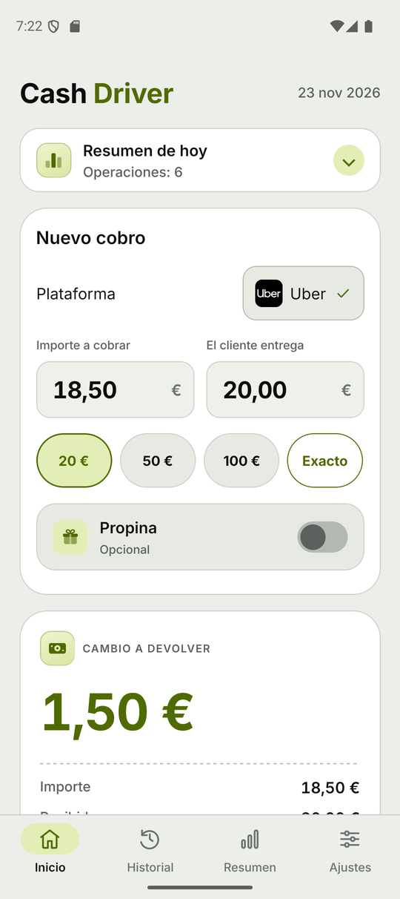                                     | 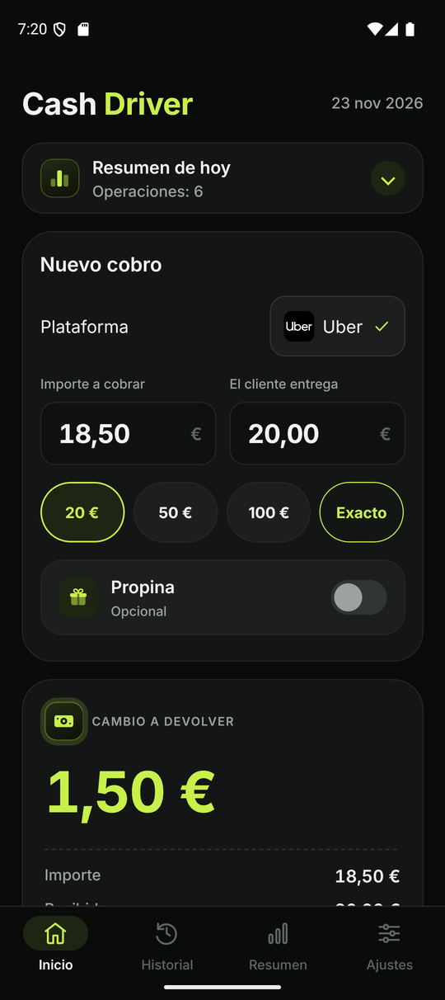                                     |
| **Resumen** — totales y barras diarias del mes                                                                 | 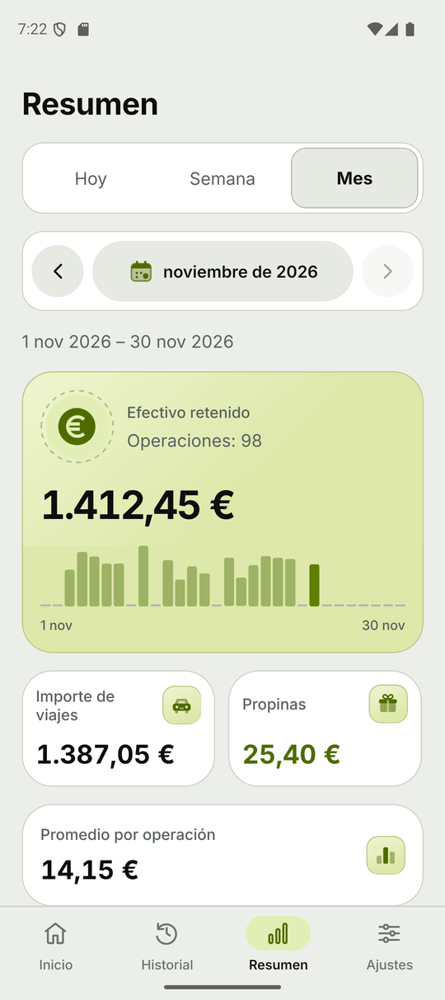                         | 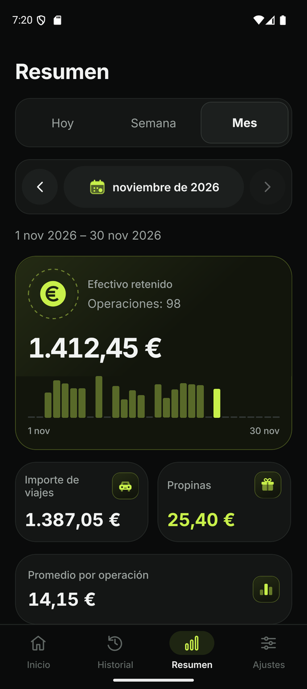                         |
| **Historial** — cobros agrupados por día con el total diario                                                   | 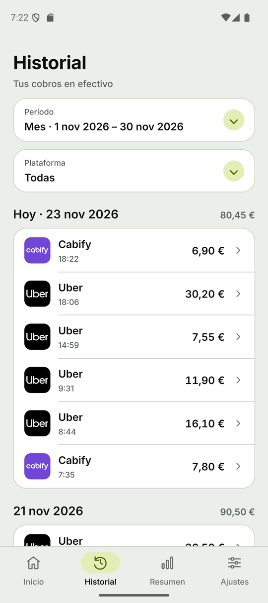                               | 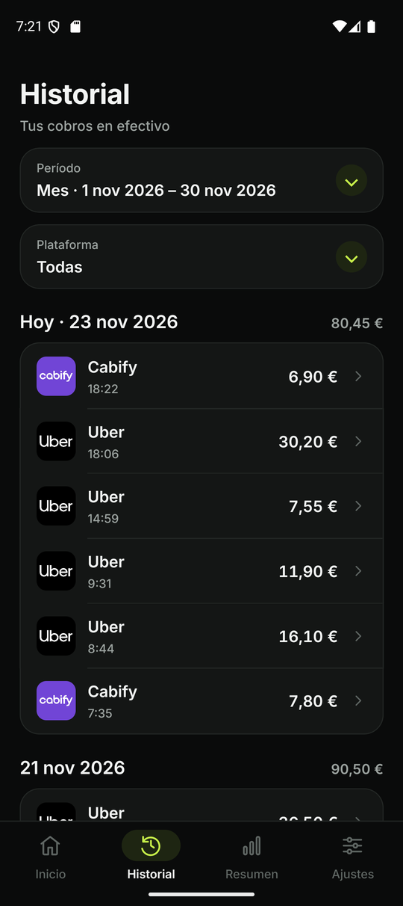                               |
| **Calendario** — selección de día, mes y año; los puntos indican días con operaciones de todas las plataformas | 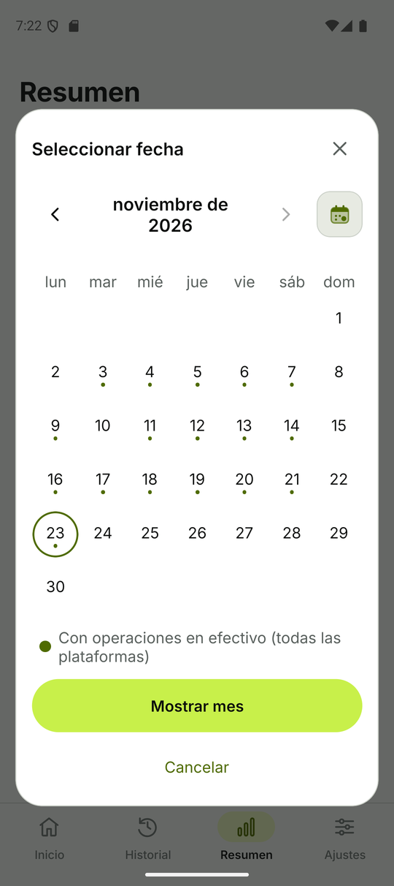 | 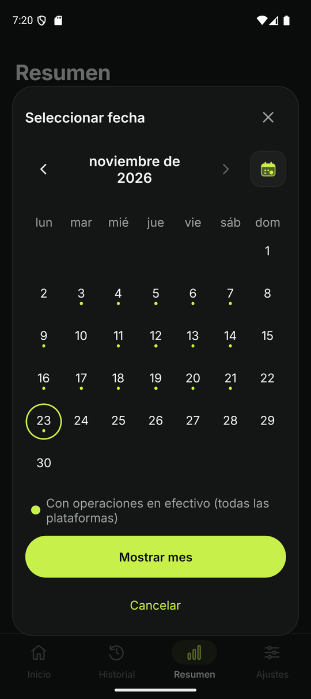 |
| **Ajustes · Datos** — exportar un mes, copia de seguridad y restauración                                       | 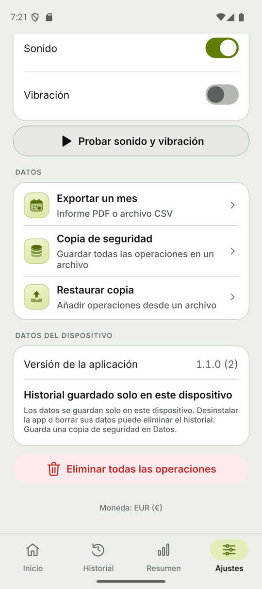                       | 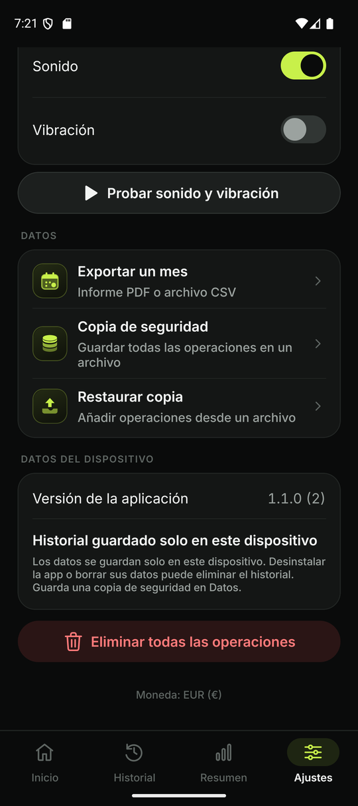                       |
| **Exportar** — elegir un mes con cobros y después PDF o CSV                                                    | 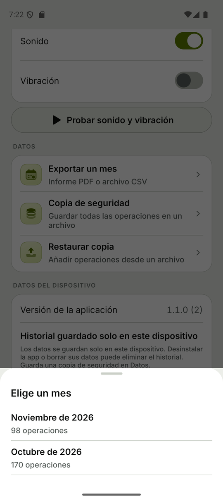            | 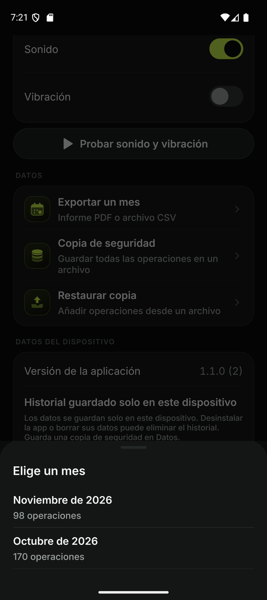            |

Cuatro pestañas: **Inicio** para registrar cobros, **Historial** para consultar operaciones, **Resumen** para ver totales y **Ajustes** para configurar preferencias y datos (exportar, copia de seguridad y restauración). El calendario está disponible en Historial y Resumen. Al explorar otro mes, la selección sigue siendo un borrador hasta que se aplica. La cruz y «Cancelar» cierran el calendario sin cambiar el período aplicado.

## Exportar, copia de seguridad y restauración

Abre **Ajustes → Datos**.

- **Exportar un mes.** Elige un mes con cobros y después **Informe PDF** o **Archivo CSV**. El PDF incluye los totales del mes (cobros, importe de los viajes, propinas, efectivo retenido, importe medio), el desglose por plataforma y una tabla por día. El CSV enumera todos los cobros del mes (fecha, hora, plataforma, importe, efectivo entregado, cambio, propina, efectivo neto) con una fila de totales; en español usa `;` y coma decimal, en inglés `,` y punto decimal, para que se abra correctamente en Excel.
- **Copia de seguridad.** Guarda todos los cobros en un único archivo `.json`.
- **Restaurar copia.** Elige un archivo de copia. La app lo valida, muestra cuántos cobros y qué fechas contiene y pide confirmación. Solo se añaden los cobros que todavía no existen; los actuales nunca se sobrescriben.

Android muestra sus cuadros normales de «guardar como» y de selección de archivos, así que eliges dónde guardar (Archivos, Drive, etc.). No se envía nada automáticamente. Las copias contienen solo los cobros, no los ajustes (idioma, tema, plataformas). La copia de seguridad automática de Android está desactivada: guarda una copia antes de desinstalar la app o de actualizarla con otra clave de firma.

## Solución técnica

| Área                 | Implementación                                                                                                                                                                                                                 |
| -------------------- | ------------------------------------------------------------------------------------------------------------------------------------------------------------------------------------------------------------------------------ |
| Aplicación           | React Native CLI 0.87.1, React 19.2.3, TypeScript                                                                                                                                                                              |
| Navegación           | Pestañas de React Navigation y pantallas de detalles/edición                                                                                                                                                                   |
| Almacenamiento       | SQLite local mediante `@op-engineering/op-sqlite`, con migraciones versionadas                                                                                                                                                 |
| Dinero               | Céntimos enteros; reglas compartidas para crear, editar y resumir operaciones                                                                                                                                                  |
| Historiales grandes  | Paginación SQL, resúmenes agregados y marcadores compactos de actividad en el calendario                                                                                                                                       |
| Fechas               | Límites de calendario locales que contemplan zonas horarias y cambios de horario de verano                                                                                                                                     |
| Apariencia           | Componentes y tokens de tema compartidos; diseño oscuro premium «Lime night» con tema claro; iconos duotono sólidos; tema automático según el sol con el tema del dispositivo como alternativa                                 |
| Respuesta al guardar | Sonido incluido para uso sin conexión y vibración nativa después de guardar correctamente                                                                                                                                      |
| Exportación y copias | CSV y un generador de PDF propio en TypeScript, sin dependencias; copias JSON con validación estricta; cuadros del sistema para guardar y abrir mediante `@react-native-documents/picker` y `react-native-blob-util` (Android) |
| Estabilidad          | Un controlador de errores en la raíz muestra una pantalla con «Reintentar» en lugar de cerrar la app ante un error inesperado                                                                                                  |
| Verificación         | Jest, TypeScript, ESLint, Prettier y escenarios nativos de aceptación aislados                                                                                                                                                 |

El SQL se mantiene en los repositorios, las reglas monetarias en funciones de dominio y los hooks de React coordinan la carga y el estado de las pantallas. La base personal nunca se utiliza para generar datos de prueba. El código de producción no importa los puntos de entrada de pruebas.

**Los datos se guardan únicamente en el dispositivo.** No hay sincronización en la nube. Puedes guardar y restaurar una copia de seguridad manualmente (consulta _Exportar, copia de seguridad y restauración_), pero la copia automática de Android está desactivada. Desinstalar la app o borrar su almacenamiento puede eliminar el historial de forma permanente si no has guardado una copia. Registrar cobros no requiere internet. El tema Automático puede solicitar una ubicación aproximada después de seleccionar explícitamente ese modo.

## Cómo generar el APK

Estas instrucciones utilizan **Windows / PowerShell**. Ejecuta los comandos desde la raíz del proyecto descargado o clonado, salvo que un paso indique otra cosa.

### 1. Prepara el entorno

Necesitas:

- Node.js **22.11.0+** y npm.
- **JDK 17** con `JAVA_HOME` configurado.
- Android Studio / Android SDK: **Platform 37**, **Build-Tools 37.0.0**, **NDK 27.1.12297006**; las versiones se declaran en `android/build.gradle`.
- El SDK disponible mediante `ANDROID_HOME` o un archivo local `android/local.properties` con `sdk.dir`.

La primera descarga de dependencias requiere internet. **No necesitas un teléfono, un emulador ni Metro para generar un APK de release.**

### 2. Instala las dependencias

```powershell
npm ci
```

### 3. Configura la firma de release

Para actualizar una instalación existente de CashDriver necesitas **la misma clave de firma** utilizada en el release anterior. Usa la clave actual del proyecto; no generes otra para una recompilación normal.

Gradle lee el archivo:

```text
%USERPROFILE%\.cashdriver\signing\release.properties
```

Ejemplo de estructura: sustituye los valores por los tuyos y nunca publiques contraseñas:

```properties
storeFile=C:/path/outside/repository/cashdriver-release.p12
storePassword=YOUR_STORE_PASSWORD
keyAlias=YOUR_KEY_ALIAS
keyPassword=YOUR_KEY_PASSWORD
```

El formato del almacén de claves es **PKCS12**. Para utilizar otro archivo de propiedades durante la sesión actual de PowerShell:

```powershell
$env:CASHDRIVER_SIGNING_PROPERTIES = 'C:\path\outside\repository\release.properties'
```

Mantén la clave y el archivo de propiedades fuera de Git y conserva una copia de seguridad. La compilación de release falla si la firma no está configurada; nunca utiliza automáticamente la firma de debug. El propietario del proyecto puede tener la firma configurada: en ese caso, no hace falta repetir este paso.

### 4. Comprueba y compila el proyecto

```powershell
npm run typecheck
npm run lint
npm run format:check
npm test -- --runInBand
```

Si las comprobaciones pasan, genera el APK de release:

```powershell
npm run android:apk
```

Incluye las arquitecturas **arm64-v8a** y **armeabi-v7a** (unos 49 MB), que cubren prácticamente todos los teléfonos Android actuales; x86 solo sirve para emuladores. El script equivale a ejecutar `.\gradlew.bat :app:assembleRelease -PreactNativeArchitectures=arm64-v8a,armeabi-v7a` en la carpeta `android`. Un `assembleRelease` normal empaqueta las mismas dos arquitecturas, pero compila las cuatro y tarda más.

Espera a que aparezca **BUILD SUCCESSFUL**. El APK firmado se genera en:

```text
android/app/build/outputs/apk/release/CashDriver.apk
```

Para abrir su carpeta desde la raíz del proyecto:

```powershell
explorer.exe .\android\app\build\outputs\apk\release
```

Después de realizar más cambios, repite las comprobaciones y `npm run android:apk`. El archivo `CashDriver.apk` se actualizará. No es necesario ejecutar `clean` en cada compilación.

## Cómo transferir el APK e instalarlo en Android

1. **Obtén el archivo.** Utiliza el `CashDriver.apk` que has generado. Si recibes un APK para instalarlo, descárgalo en el teléfono desde una fuente de confianza. Este README no incluye un enlace a un APK publicado.
2. **Transfiérelo por USB** si el APK está en el ordenador: conecta el teléfono Android, selecciona «Transferencia de archivos» y copia el APK, por ejemplo, a la carpeta `Download` del teléfono.
3. **Abre el APK** desde «Mis archivos» u otro gestor de archivos. Si Android lo solicita, permite que ese gestor instale aplicaciones desde esa fuente.
4. Pulsa **Instalar** o **Actualizar**, espera a que termine y abre **CashDriver**. Después puedes desactivar el permiso del gestor para instalar aplicaciones desconocidas.

Si tienes ADB y la depuración USB está activada, también puedes instalarlo desde el ordenador:

```powershell
adb devices
adb install -r .\android\app\build\outputs\apk\release\CashDriver.apk
```

Este ejemplo supone que hay un solo dispositivo Android conectado. Si hay varios, selecciona el correcto con `adb -s SERIAL install -r ...`.

### Actualizaciones y conservación del historial

- Application ID: **`com.alexm.cashdriver`**. Consérvalo junto con la clave de firma actual para las actualizaciones normales.
- La versión actual es la **1.1.0** (`versionCode` 2). Antes de distribuir un nuevo release, incrementa `versionCode` en `android/app/build.gradle` y ajusta `versionName` según la versión. No es necesario cambiar el número en cada intento de compilación local.
- **Si Android indica que la firma es incompatible, no desinstales todavía la app anterior.** Ocurre al instalar un release sobre una versión debug. Desinstalar o borrar los datos elimina el historial local; por eso guarda primero una copia (Ajustes → Datos → Copia de seguridad), desinstala, instala el nuevo APK y restaura la copia.
- La opción `-r` de ADB solicita reinstalar conservando los datos. No evita la comprobación de la firma ni sustituye las copias de seguridad.

## Ejecución durante el desarrollo

El modo debug requiere un emulador Android o un teléfono con depuración USB. Desde la raíz del proyecto, utiliza dos terminales:

```powershell
# Terminal 1 — Metro
npm start
```

```powershell
# Terminal 2 — compilar y ejecutar la app de debug
npm run android
```

Las versiones debug están destinadas al desarrollo. Utiliza un **APK de release** para instalar la app de forma independiente y usarla sin Metro. Los archivos de iOS permanecen en el repositorio para un posible desarrollo futuro, pero actualmente no se ofrece compilación ni soporte para iOS.

Para comprobar bases grandes de forma aislada, ejecuta `assembleAcceptance` por separado desde la carpeta `android`. Genera el paquete `com.alexm.cashdriver.acceptance` con datos de prueba. **No es el APK para uso diario.** Compila acceptance y release en comandos separados.
