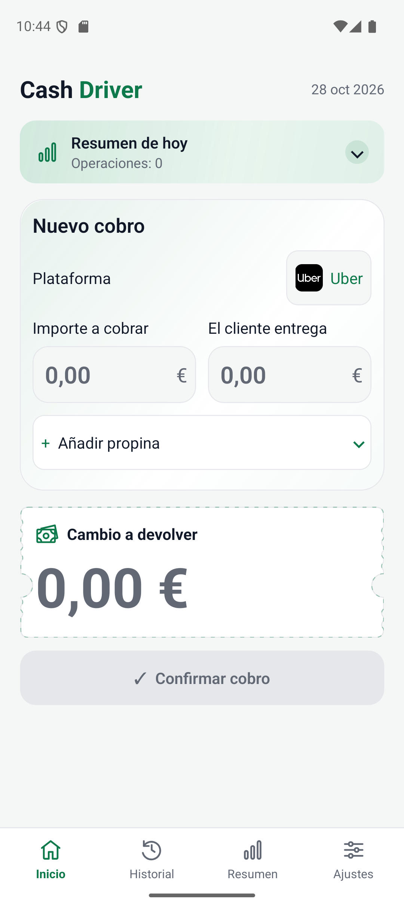
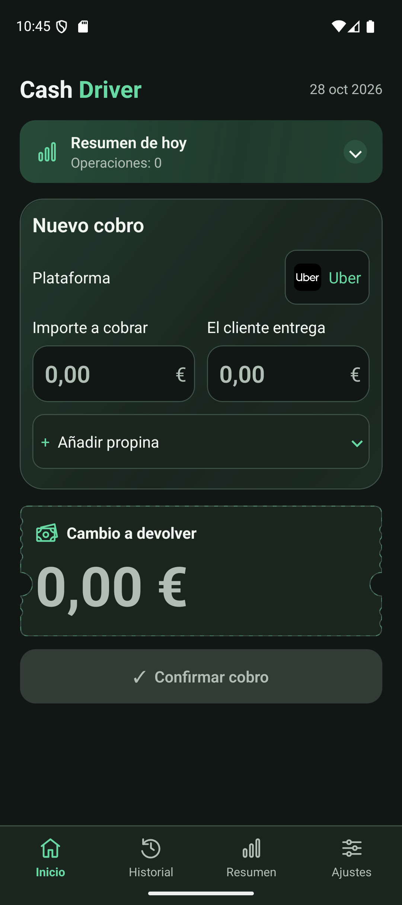
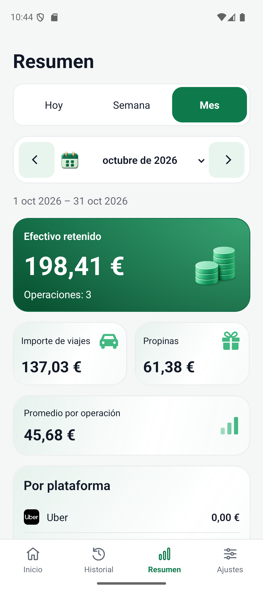
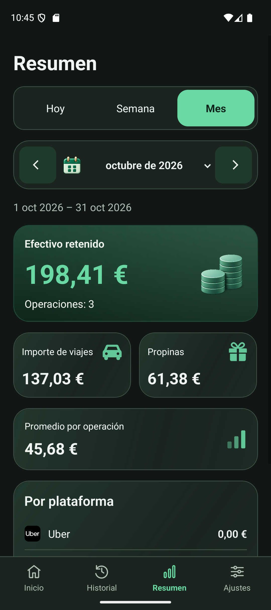
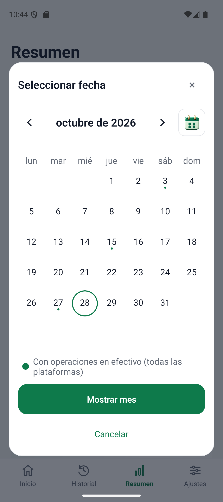
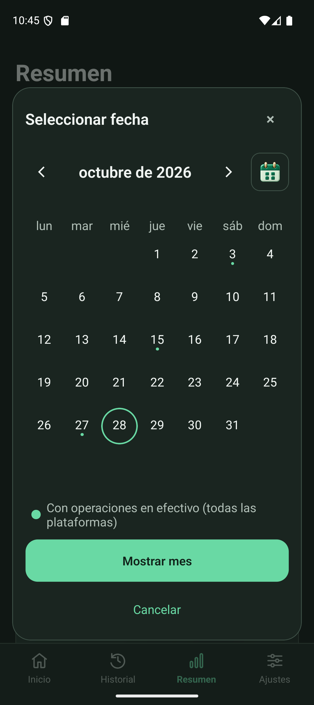

# CashDriver

**English** · [Español](README.es.md) · [Українська](README.uk.md)

### Cash payments for drivers — change, tips, and history in one app.

**CashDriver** is an Android app for taxi and ride-hailing drivers. It helps you calculate change, record tips, and review cash payments by day, week, or month. It works **offline**, without registration or a required backend.

Choose a platform → enter the fare and cash received → check the change → confirm the payment. The saved payment automatically appears in your history and summaries.

> Supported platform: **Android 7.0+**. App languages: **Español / English**. Currency: **EUR**. iOS is not currently supported; APK files cannot be installed on an iPhone.

## What CashDriver helps you do

- **Calculate change immediately.** Use comma or period decimal input, quick cash amounts, and “Exacto” for exact payment.
- **Track tips separately.** Enter a specific tip or keep all the change as a tip.
- **Keep a useful payment history.** Find a period through the calendar, filter by platform, view details, edit, and delete individual payments with an Undo opportunity.
- **Understand your totals.** Review fares, tips, retained cash, payment count, average fare, and fare totals by platform.
- **Adapt the app to your work.** Choose Uber, Cabify, Bolt, and Taxi; light, dark, or automatic appearance; separate sound and vibration switches with a preview button.

**Example:** the fare is **€20**, the customer hands over **€50**, and the tip is **€5**. Return **€25**; retained cash is **€25**: the fare plus the tip.

Platforms are manually selected labels. CashDriver does not connect to their accounts. Cash totals exclude expenses and commissions and are not a profit calculation.

## Screenshots

Actual Android emulator screenshots using synthetic demo data and the Spanish interface. No personal payment records were used.

| Screen                                                                                          | Light theme                                                                                                                | Dark theme                                                                                                               |
| ----------------------------------------------------------------------------------------------- | -------------------------------------------------------------------------------------------------------------------------- | ------------------------------------------------------------------------------------------------------------------------ |
| **Inicio / Home** — new payment, tips, and change                                               |                               |                               |
| **Resumen / Summary** — totals for the selected period                                          |                 |                 |
| **Calendar** — choose a day, month, or year; dots mark dates with payments across all platforms |  |  |

Four tabs: **Inicio / Home** for payments, **Historial / History** for saved records, **Resumen / Summary** for totals, and **Ajustes / Settings** for preferences. The calendar is available in History and Summary. Browsing another month remains a draft until you apply it. The close button and “Cancelar / Cancel” dismiss it without changing the applied period.

## Technical approach

| Area            | Implementation                                                                                 |
| --------------- | ---------------------------------------------------------------------------------------------- |
| Application     | React Native CLI 0.87.1, React 19.2.3, TypeScript                                              |
| Navigation      | React Navigation tabs and details/edit screens                                                 |
| Storage         | Local SQLite through `@op-engineering/op-sqlite`, versioned migrations                         |
| Money           | Integer cents; shared rules for payment creation, editing, and summaries                       |
| Large histories | SQL pagination, aggregated summaries, and compact calendar activity markers                    |
| Dates           | Local calendar boundaries that account for time zones and daylight-saving changes              |
| Appearance      | Shared components and theme tokens; solar automatic theme with device appearance as a fallback |
| Feedback        | Bundled offline sound and native vibration after a successful save                             |
| Verification    | Jest, TypeScript, ESLint, Prettier, and isolated native acceptance scenarios                   |

SQL lives in repositories, money rules in domain functions, and React hooks coordinate loading and screen state. Test seeding never uses the personal database. Production code does not import test entrypoints.

**Data is stored only on the device.** Cloud sync, backup, and restoration are not currently included. Uninstalling the app or clearing its storage can permanently erase your history. Recording payments does not require internet access. Automatic appearance may request approximate location after you explicitly select that mode.

## Build the APK

These instructions use **Windows / PowerShell**. Run commands from the root of the downloaded or cloned project unless a step says otherwise.

### 1. Prepare the environment

You need:

- Node.js **22.11.0+** and npm.
- **JDK 17** with `JAVA_HOME` configured.
- Android Studio / Android SDK: **Platform 37**, **Build-Tools 37.0.0**, **NDK 27.1.12297006** — the versions are declared in `android/build.gradle`.
- The SDK available through `ANDROID_HOME` or a local `android/local.properties` file containing `sdk.dir`.

Internet access is needed for the initial dependency downloads. **A phone, emulator, and Metro are not required to build a release APK.**

### 2. Install dependencies

```powershell
npm ci
```

### 3. Configure release signing

Updating an existing CashDriver installation requires **the same signing key** used for the previous release. Use the project's existing key; do not generate a replacement for an ordinary rebuild.

Gradle reads:

```text
%USERPROFILE%\.cashdriver\signing\release.properties
```

Example file structure — replace the placeholders with your own values and never publish passwords:

```properties
storeFile=C:/path/outside/repository/cashdriver-release.p12
storePassword=YOUR_STORE_PASSWORD
keyAlias=YOUR_KEY_ALIAS
keyPassword=YOUR_KEY_PASSWORD
```

The keystore format is **PKCS12**. To use a different properties file for the current PowerShell session:

```powershell
$env:CASHDRIVER_SIGNING_PROPERTIES = 'C:\path\outside\repository\release.properties'
```

Keep the key and properties file outside Git and retain a backup. A release build fails if signing is not configured; it never falls back to debug signing. The project owner may already have signing configured, in which case this step does not need repeating.

### 4. Check and build

```powershell
npm run typecheck
npm run lint
npm run format:check
npm test -- --runInBand
```

If the checks pass:

```powershell
cd android
.\gradlew.bat assembleRelease
cd ..
```

Wait for **BUILD SUCCESSFUL**. The signed APK is written to:

```text
android/app/build/outputs/apk/release/CashDriver.apk
```

Open its folder from the project root:

```powershell
explorer.exe .\android\app\build\outputs\apk\release
```

After making further changes, repeat the checks and `assembleRelease`. The `CashDriver.apk` file will be updated. Running `clean` on every build is unnecessary.

## Transfer and install on an Android phone

1. **Get the file.** Use your built `CashDriver.apk`. If someone provides an APK for installation, download that file from a trusted source onto your phone. This README does not include a published APK download link.
2. **Transfer by USB** if the APK is on your computer: connect your Android phone, select “File transfer,” and copy the APK to a folder such as `Download` on the phone.
3. **Open the APK** in “My Files” or another file manager. If Android asks, allow that file manager to install apps from this source.
4. Tap **Install** or **Update**, wait for completion, and open **CashDriver**. You can disable the file manager's permission to install unknown apps afterward.

If ADB is available and USB debugging is enabled, you can install from your computer:

```powershell
adb devices
adb install -r .\android\app\build\outputs\apk\release\CashDriver.apk
```

This example assumes one connected Android device. If several are connected, select the intended device explicitly with `adb -s SERIAL install -r ...`.

### Updates and your history

- Application ID: **`com.alexm.cashdriver`**. Preserve it and the existing signing key for normal updates.
- Before a new distributed release, increase `versionCode` in `android/app/build.gradle` and set `versionName` as appropriate. You do not need to change the version for every local build attempt.
- **If Android reports an incompatible signature, do not uninstall the old app.** This can happen when installing a release over a debug version. Uninstalling the old version or clearing its data erases local history; first determine which key signed the installed app.
- ADB's `-r` flag requests reinstallation while retaining data. It does not bypass signature verification or replace backups.

## Development

Debug mode requires an Android emulator or a phone with USB debugging. From the project root, use two terminals:

```powershell
# Terminal 1 — Metro
npm start
```

```powershell
# Terminal 2 — build and launch the debug app
npm run android
```

Debug builds are for development. Use a **release APK** for standalone installation and operation without Metro. iOS files remain in the repository for possible future development, but iOS builds and support are not currently offered.

For isolated large-database checks, run `assembleAcceptance` separately from the `android` folder. It creates `com.alexm.cashdriver.acceptance` with test data. **This is not the APK for everyday use.** Build acceptance and release in separate commands.
