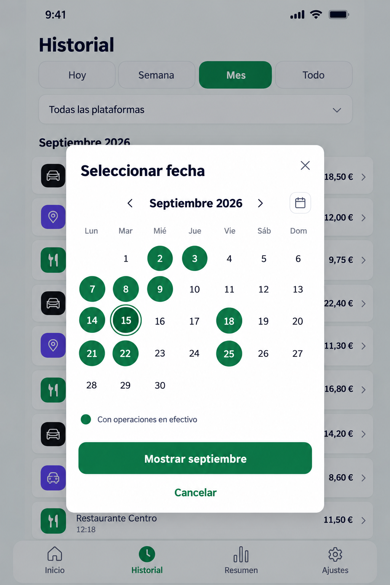
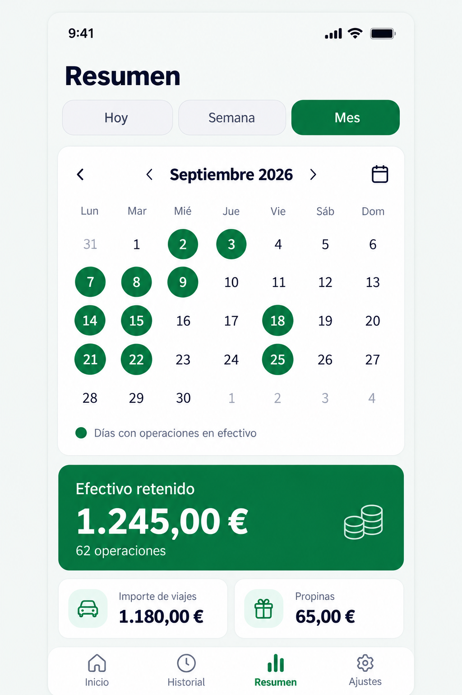
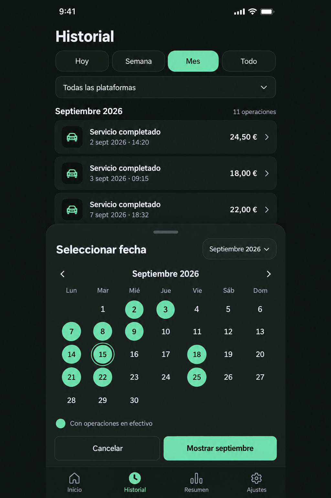
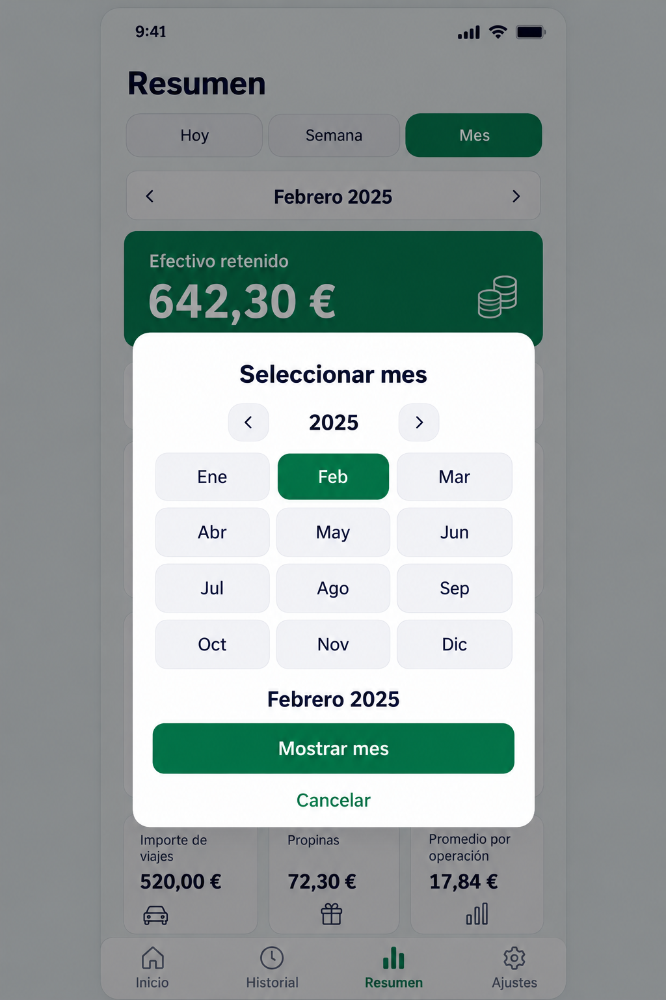

# Calendar and history performance — temporary implementation plan

Date: 2026-10-10; Phase 6 handoff 2026-10-11. Status: **Phases 0–5 COMPLETE for implementation/automated/build scope; Phase 6 PARTIALLY VERIFIED / NOT COMPLETE**. Native Android volume and selected behavior passed; iOS and full accessibility/scenario acceptance remain open. Current evidence is in IMPLEMENTATION_PLAN.md.

This file covers the owner-requested Historial/Resumen calendar, historical month selection, large-history loading and loading feedback. The owner subsequently authorized the first stage, interpreted and announced as Phase 0 read-only implementation inventory and baseline. Future application changes require their assigned phase. Do not restart historical MVP/refactoring/tip phases.

## Authority and protected behavior

Read README.md, AGENTS.md, PROJECT_SPEC.md, UI_DESIGN.md, DATA_AND_CALCULATIONS.md, IMPLEMENTATION_PLAN.md and CODING_STANDARDS.md before execution. Apply the local architecture, domain and UI skills linked from AGENTS.md. Latest owner instructions win; this temporary plan proposes extension behavior and does not silently replace permanent contracts.

Preserve React Native CLI/TypeScript, offline SQLite, four tabs/platforms, integer cents, exact tips, original createdAt on edit, duplicate-save protection, failed drafts, commit-only refresh and deferred deletion. No shifts, expenses, commissions, profit inference, remote services or editable transaction dates. Existing native/iOS/haptics gates remain open independently of this extension.

Phases 0–1 changed documentation only; Phase 2 implements pure dates and bounded repository/service reads with tests; Phase 3 implements query/calendar hooks and request lifecycle; Phase 4 implements the shared localized UI. Phase 5 integrates screens and aligns the final UI to modal01/month chooser04, with icon navigation, draft preview/apply and adaptive geometry. Fresh checks and actual Android evidence live in IMPLEMENTATION_PLAN.md. Phase6 is partially verified; Phase7 is unstarted. Node SQLite results do not establish native performance; selected Android visual checks do not establish complete native/accessibility acceptance.

## Extension contracts formalized in Phase 1

Permanent requirements now live in PROJECT_SPEC.md, UI_DESIGN.md and DATA_AND_CALCULATIONS.md. This plan summarizes them; those documents govern scope, presentation and data respectively. The actual verification record and future acceptance matrix live in IMPLEMENTATION_PLAN.md.

### Visual concepts — generated 2026-10-10

The owner requested keeping these four generated mockups with this plan. They are imagegen visual concepts, not screenshots of implemented functionality or native acceptance evidence. All displayed records and monetary values are illustrative. Written product/data/UI contracts take precedence over image details: retain the four platform labels, correct history ordering, all required summary metrics and exact arithmetic. Generated labels, icons, duplicate arrows or inconsistent sample totals are not implementation requirements.

Phase 1 selects the centered light calendar modal composition (concept 1), adapted to existing dark tokens, with quick month/year selection (concept 4), as one shared presentation across both screens/themes. Concept 3 demonstrates colors but its bottom-sheet presentation is an alternative, as is concept 2's inline layout. Do not implement additional presentation modes by default; generated pixels are not a separately approved final design.

#### 1. Historial — light calendar modal

Green circles indicate dates with saved cash operations; a separate outline indicates selection. Keep the history visible behind the modal and apply the displayed month through the primary action.

#### 2. Resumen — inline calendar alternative

An expanded calendar above period totals. This alternative occupies more screen height and is provided for comparison, not as an additional mandatory view.

#### 3. Historial — dark bottom-sheet alternative

Dark surfaces and mint activity markers demonstrate theme adaptation. Bottom-sheet presentation is a visual alternative; Phase 1 selected the centered shared modal rather than separate behavior per theme.

#### 4. Quick year/month selection

A year navigation row and twelve month choices allow direct access to historical periods without repeated month-by-month navigation. Integrate this view with the calendar's draft/apply/cancel contract.

These files live in docs/calendar_mockups/. During Phase 7, retain useful selected references and move their links into UI_DESIGN.md before deleting this temporary plan; the images are not automatically deleted with it. Remove unneeded concepts only under a separate explicit cleanup instruction.

### Period and calendar

- Keep Hoy and Semana behavior unchanged. Historial retains Todo and its platform filter.
- Entering Mes initially selects the current local calendar month, which follows rollover until explicit navigation. After explicit selection, preserve its calendar coordinates during refresh, screen revisit within the same session, and language/theme changes; recompute bounds after a time-zone change. Re-entering Mes restores that screen's automatic or explicit calendar month/day selection. Restart starts at Hoy; no preference migration.
- Both screens use one reusable period/calendar component and shared period rules. Filter state is local to each screen: changing Historial does not unexpectedly change Resumen.
- In Mes show localized month/year, previous/next arrows and a calendar button. External arrows apply/pin a month immediately; internal arrows only browse the draft. Open one centered dismissible modal with one visible month, arrows, a quick year/month selector and a day grid. Support historical years without rendering every month or imposing an arbitrary history cutoff. Day is a Mes submode, not Hoy.
- Navigating the modal changes only its draft selection. “Show month” applies the displayed month; selecting a day applies that local date as an explicit calendar selection. Cancel, backdrop dismissal and native Back preserve the prior applied filter. Day selection does not redefine Hoy or Semana; show its full date and a clear return-to-month action.
- Future days/months may be viewed and show the ordinary empty state; navigation does not create records. Opening the modal starts at the applied month or the selected date's month.
- A green circular background means at least one saved cash operation exists on that local date. A plain date means no saved cash operation; never label it “day off” or assert the driver did not work.
- Calendar markers represent all platforms, consistently on both screens. The Historial platform filter applies to the list, not to activity markers; explain this in the legend. A marked date can therefore have no operations for the selected platform.
- Distinguish today with an outline and the selected date with an additional selection indicator/text. Preserve activity marking when either coincides. Do not communicate state through color alone; accessible labels announce full date, activity, today and selection as applicable.
- Use ES/EN/UK translations, existing locale/date formatting, Monday as first weekday, reactive light/dark tokens, safe areas and accessible touch targets. Do not shrink essential text or suppress font scaling.
- Historial lists only the applied period/platform, grouped by local date and sorted createdAt descending with a stable ID tie-breaker. Resumen keeps existing count, fare, tip, retained cash, average fare and platform totals. Retained cash is not salary or profit.

### Library decision

Preferred candidate: **react-native-calendars by Wix**, using Calendar with custom date marking/theme integration. Official references: [Calendar API](https://wix.github.io/react-native-calendars/docs/Components/Calendar), [repository](https://github.com/wix/react-native-calendars).

This is a candidate selection, not verified project compatibility. Phase 0 must inspect the actual installed React Native/React versions, native architecture, dependency requirements and license, and check current official documentation. Reuse an existing compatible calendar dependency if present. Record the exact selected version and rationale before installing in an authorized coding phase. Build the small year/month selector with existing project controls; do not add another date-picker or styling framework without a demonstrated need. Use explicit application loading state; do not assume the library's loading indicator accurately represents our query lifecycle.

### Data volume and feedback

- SQLite remains authoritative. Read only the applied time range; use local calendar boundaries converted to UTC, start inclusive/end exclusive. Construct dates by calendar rules, including DST and year/leap-year transitions, rather than fixed-duration arithmetic.
- Historial uses bounded pages with a createdAt/ID cursor and one consistent tie-breaker direction. Avoid growing OFFSET pagination and loading the full database. Phase 0 confirmed there is no existing virtualized list: introduce one SectionList/FlatList viewport preserving date-group headers, safe areas and spacing. Do not nest it inside ScreenContainer's existing vertical ScrollView.
- Define and record the page size in Phase 2 based on inspection/measurement. No unverified capacity, latency or memory targets. Prevent duplicate concurrent load-more requests and stop at end-of-list.
- Resumen obtains validated aggregates in SQLite over its range instead of transferring all transactions. DATA_AND_CALCULATIONS.md now explicitly defines query-scoped validation: summary/activity validate all matched rows, history validates returned rows. This replaces incidental failures from unrelated rows under old full-table reads; it is not a global integrity audit. Preserve exact integer results and corruption errors for matched rows, with consistent snapshot/type/date/platform/arithmetic/overflow checks.
- Activity loading returns only distinct occupied local dates for the displayed month, not transaction objects. Match grouping to the device time zone, including DST; do not group UTC dates or use a fixed offset. Phase 2 must establish a correct, bounded approach compatible with the actual SQLite adapter. If native SQL cannot express those boundaries reliably, evaluate queries over independently constructed local-day UTC intervals. Measure the chosen approach; do not load a month of full records as a fallback.
- Documentation already declares indexes on created_at and (platform, created_at). Verify the actual schema/query plans first. Add a composite cursor index only if justified by EXPLAIN QUERY PLAN and measurements, through a non-destructive versioned migration; do not change schema merely for the calendar.
- Cache only bounded derived month activity/summary results where useful. Include period, applicable platform and device time zone in identity; invalidate affected data after successful create/edit/delete/delete-all. Avoid permanent duplicate totals/activity tables and unbounded caches.
- Pending deletion leaves records, totals and markers present until commit. Undo/background cancellation changes none of them; failure preserves them. Delete-all clears derived results only after successful commit.
- Initial load: visible loader in the data area. Load-more: footer spinner, existing rows retained. Refresh: subtle progress with explicitly identified prior data. Switching period: do not present prior-period data as the newly selected period. Calendar shell stays usable while markers load; do not present unknown activity as confirmed absence.
- Errors show localized Retry, never fake zeros, empty history or unmarked activity. Empty states and zero totals are valid only after a successful query. No artificial loading delay.
- Each request has a period/filter/time-zone generation guard. Late results cannot replace newer selections. Clean subscriptions on unmount; coalesce repeated invalidations. On resume/date/time-zone change, update relative Hoy/Semana/current-month selection and recompute boundaries; explicitly selected historical month/day stays selected.

## Execution and phase gates

Main agent owns integration and phase scope. During each phase, use a bounded subagent for an independent read-only review of relevant requirements/diff/tests. If assigning implementation agents, give disjoint files, shared contracts first and no later-phase work. Reviewers report concrete defects and missing coverage; main agent resolves confirmed issues and reruns affected checks. Record actual delegation or tool limitations, never fabricate review.

Reuse fitting React hooks for clock/resume, subscriptions, history, period summary, theme and language. Extend existing hooks before creating alternatives; a new hook is justified only for cohesive calendar/period state or paginated loading. Keep date/arithmetic pure and SQL in repositories. React hooks are not Git checks.

Inspect and reuse existing active Git hooks/CI at Phase 0 and before phase completion. Sample hooks do not count as active. Do not bypass failures or install a hook framework just for this feature. A commit is not required solely to trigger a hook: run its available checks directly when appropriate and report what actually ran.

After **every phase**, including documentation phases, run the existing typecheck, lint and full Jest commands, plus relevant new behavioral/integration checks. Expected command names from the handoff: `npm run typecheck`, `npm run lint`, `npm test -- --runInBand --no-cache --watch=false`; verify actual package scripts in Phase 0. Use supported test time zones for calendar tests. Do not silently change configuration to make checks pass. Record commands, results, failed/unavailable checks and environment limitations. These are baseline/regression checks for documentation phases, not proof of UI or performance. A failing required check prevents marking its gate passed or starting a dependent phase.

At every handoff update the phase registry below and record scope, changed files, main flow, tests, agent findings/resolution and remaining gates. Durable results go in IMPLEMENTATION_PLAN.md under a dedicated extension section. Do not claim native acceptance from Jest. Temporary test data must be isolated from the installed production database; never clear user history for verification.

## Phase 0 — read-only implementation inventory and baseline

1. Inspect current source/tests/package scripts/dependencies/schema within the assigned read-only scope. Completed Phase 0 observations are recorded in IMPLEMENTATION_PLAN.md.
2. Map existing History/Summary screen entries, filter/date utilities, repositories/services, aggregation, loaders, clock/change-notification hooks, providers, translations and integration tests. Record concrete paths, reusable hooks and current full-table/list-loading behavior.
3. Inspect active Git hooks/CI, native architecture and calendar compatibility. Check existing indexes and migration chain.
4. Establish baseline checks and an isolated large-history fixture plan. Identify existing corrupt-row validation and summary overflow protection before optimizing.
5. Read-only agent reviews scope and baseline risks; no code edits in this phase.

Gate: actual implementation map, library compatibility decision, baseline results and unresolved blockers recorded. Historical test counts are not a fresh baseline.

## Phase 1 — permanent extension contracts

1. Update PROJECT_SPEC.md with month/year/day navigation and scope; retain current-day/week functionality.
2. Update UI_DESIGN.md with modal draft/apply/cancel behavior, markers/legend, selected/today distinction, day/month return, all loading/error/empty states and accessibility.
3. Update DATA_AND_CALCULATIONS.md with selected-date/month boundaries, stable cursor ordering, activity semantics/time-zone handling, aggregate validation and invalidation/deletion rules. SQL details follow inspection, not guesswork.
4. Update IMPLEMENTATION_PLAN.md with actual implementation map, dependency decision, acceptance matrix and extension handoff. Add a temporary link to this plan in README.md and AGENTS.md only for the active assigned work; do not make old phases active again.
5. Agent reconciles product/UI/data contracts; run phase checks.

Gate: no ambiguity between global activity markers and filtered list, relative/current versus explicit historical selection, or draft versus applied modal state. No invented verification results.

## Phase 2 — date/query contracts and bounded storage reads

1. Extend pure local-day/month range utilities and typed filter/cursor/page/result contracts using existing feature locations.
   Preserve descending createdAt and descending ID. Current service writes ISO UTC via toISOString(), but decoding accepts any Date.parse-compatible string; establish canonical timestamp ordering for supported stored data before relying on a text cursor. Do not silently reinterpret legacy rows. Current full-table decoding rejects corruption even outside the selected period: Phase 1 must explicitly document the bounded-read validation scope before changing that behavior. SQL aggregate validation must retain type/platform/date/arithmetic and safe-integer checks for the documented scope.
2. Implement repository pagination, validated period/platform aggregates and bounded occupied-day reads. SQL stays out of screens/hooks.
3. Verify indexed range predicates and stable ordering; implement a migration only if justified, preserving rows/preferences and rollback.
4. Add meaningful real-SQLite tests: multi-page no-duplicate/no-gap traversal including identical timestamps, empty/end pages, platform/range boundaries, UTC/local disagreement, DST, leap February and year transition.
5. Verify totals/average against established monetary rules; test corrupt rows, safe-integer overflow, exact tips and query failures. Preserve existing error behavior rather than silently aggregating invalid data.
6. Agent reviews data correctness/query plans; run phase checks.

Gate: repository results agree with existing correct calculations, bounded responses, stable cursor contract and validated time-zone grouping. No unmeasured performance claim.

## Phase 3 — hooks and request lifecycle

1. Reuse/extend existing history and summary hooks for selected periods and pagination; introduce shared calendar orchestration only where reuse warrants it.
   Keep useTransactions(id, live)'s single-record/edit mode intact. Do not pass edit/detail loading through the paginated history path. Avoid repeating unchanged history grouping/formatting on useLocalClock's one-second updates; relative periods still update on local date/time-zone changes.
2. Model initial/loading-more/refresh/error/empty/end states explicitly; prevent overlapping load-more and reject stale responses after filter/month/platform changes.
3. Reuse existing commit notifications, clock/resume subscriptions and cleanup. Reset cursor/pages after mutations so insert/edit/delete cannot corrupt a partially loaded list.
4. Implement bounded cache invalidation if Phase 2 shows a need; keep today/week updates and explicit historical selections consistent.
5. Test rapid navigation, out-of-order responses, retry, unmount, resume/time-zone change, successful/failed mutations and pending deletion/undo. Explicitly test insert/edit/delete between pages and during in-flight page reads: commit invalidation advances the request generation, resets pagination and prevents old pages from merging after that reset.
6. Agent reviews lifecycle and hook reuse; run phase checks.

Gate: old requests never overwrite new filters; loading errors never become successful empty states; payment drafts and deletion authority remain intact.

## Phase 4 — shared calendar UI and localization

1. Install the verified calendar version only now, following existing dependency conventions. Implement one shared themed calendar modal and compact month/year selection controls.
2. Add occupied-day circles, distinct today/selection styles, legend, draft/apply/cancel flow and full localized accessibility announcements.
3. Match existing theme tokens and touch/spacing rules. Handle loading/error of markers separately from month navigation; no blocked navigation or misleading plain-date states during load.
4. Add matching ES/EN/UK keys using existing formatting. Preserve open modal selection and filters across theme/language updates.
5. Component tests cover observable navigation, markings, apply/cancel/native Back, year/month jumps, retry and all-language key completeness. Visually inspect narrow/large-text/light/dark layouts; inspect screen.png before UI work.
6. Agent reviews UI contracts and coverage; run phase checks and dependency/native build checks where available.

Gate: shared component works independently; library compatibility is actually checked, with unavailable Android/iOS checks explicitly reported.

## Phase 5 — Historial and Resumen integration

1. Wire shared selectors into both screens while retaining independent applied filters. Keep Hoy/Semana and Historial Todo/platform behavior.
2. Use virtualized paged history with stable keys, local-date grouping, deduplicated merged pages and accessible load-more/footer retry.
3. Replace summary loading with validated aggregate results and explicit period-specific feedback. Keep all existing monetary labels/formulas.
4. Integrate markers, day selection/return-to-month and visible date ranges. Filter changes reset pages; selection cannot expose stale values under new labels.
5. Add screen/integration tests for past-year month selection, cross-page date groups, no-record periods, marked day with empty platform filter, totals, mutations, undo/background cancellation and failed writes.
6. Agent reviews regressions across both screens and unchanged Home/edit/settings behavior; run phase checks.

Gate: selected month/day drives actual queries and results, not only the header; existing payment/tip/deletion flows remain correct.

## Phase 6 — native, volume and final behavioral acceptance

1. Use isolated deterministic fixtures with documented sizes, date distribution, platform mix and ties. Include sparse/dense months and long multi-year history; synthetic fixtures are not real user records.
2. Measure query duration, UI responsiveness and memory where tooling supports it; record device/build/data size and actual observations. Verify bounded database-to-JavaScript transfers, pagination, query plans and cache limits. Do not invent numeric pass targets.
3. Test rapid scrolling/month changes, background/resume, local date/time-zone changes, rotation, modal Back/cancel, retry and mutations while historical filters are applied.
4. Verify real SQLite results/restart, both themes, ES/EN/UK, narrow/wide layout, enlarged text, screen reader, touch targets and Reduce Motion where applicable on Android and iOS.
5. Run build checks for available platforms and all phase tests. An unavailable platform is NOT VERIFIED; record the blocker and keep native acceptance incomplete.
6. Read-only agents separately review data/lifecycle correctness and UI/accessibility acceptance evidence. Fix confirmed defects and rerun affected checks plus full regression.

Gate: explicit per-scenario evidence and remaining limitations. Automated correctness, build success, performance observations and native acceptance are separate results. Full delivery stays incomplete when required native checks are unverified.

## Phase 7 — durable handoff and removal of this plan

1. Move final permanent behavior, exact dependency choice, actual file/hook map, test/build/native/performance results and remaining unrelated gates into the existing permanent documents. Preserve decisions and evidence scope, not the whole temporary checklist. Move links to the useful selected calendar mockups into UI_DESIGN.md, preserving their concept-only disclaimer, before deleting this plan.
2. Confirm all preceding phase gates passed. If a required extension gate is incomplete, retain this plan and mark that phase incomplete; do not delete it to imply completion.
3. Run the owner-requested phase test suite and have a read-only agent verify the durable handoff before deletion. If checks fail, keep this plan and fix the failure before continuing.
4. Remove active references to this filename from README.md/AGENTS.md/other docs and delete only docs/CALENDAR_HISTORY_PLAN.md. Then check local Markdown links/references and diff/whitespace. If a final check fails, restore this plan until corrected and rechecked. Do not remove permanent evidence or clear user data.
5. Report changed files, actual verification and remaining pre-existing gates. No deployment/publication or claim of complete MVP acceptance follows automatically.

Gate: temporary file removed only after successful completion and preservation of its useful contracts/results; permanent docs remain sufficient to maintain the feature.

## Phase registry

| Phase | Status | Evidence / blockers |
| --- | --- | --- |
| Plan creation | COMPLETE for document creation only | No implementation/test/native results |
| 0 — inventory/baseline | COMPLETE | Fresh typecheck/lint PASS; Jest 25 suites / 266 tests PASS; read-only agent review/map in IMPLEMENTATION_PLAN.md. Candidate metadata verified; installation/native compatibility remains Phase 4 gate. |
| 1 — permanent contracts | COMPLETE | Permanent product/UI/data requirements and acceptance matrix; read-only agent review; fresh typecheck/lint PASS and Jest 25 suites / 266 tests PASS (10.845 s). No feature/native evidence. |
| 2 — storage/date contracts | COMPLETE | Data APIs, date helpers and isolated tests implemented; typecheck/lint PASS, 28 suites / 307 tests PASS. No UI/hook/schema changes. |
| 3 — hooks/lifecycle | COMPLETE | Calendar/activity/pagination hooks, bounded summary loading, stale response guards and commit resets; independent agent review, typecheck/lint/format PASS, Jest 32 suites / 331 tests PASS (11.047 s). No calendar UI. |
| 4 — shared calendar UI | COMPLETE for code/available checks | Exact library, shared modal/selector/navigation, 3-language keys; independent UI/dependency reviews, typecheck/lint/format PASS, Jest 34/339 PASS; Android builds and separate Android/iOS Metro/Hermes PASS. Native visual/accessibility NOT VERIFIED, retained for Phase 6. |
| 5 — screen integration | COMPLETE | Final mockup/adaptive rework: read-only review and fixes, fresh typecheck/lint/Jest37/356 PASS; Android debug/release PASS52s; selected light/dark, historical month/day and 360dp/150% text Android checks. Original size/font and Español/Oscuro restored. Full acceptance remains Phase 6; see final handoff. |
| 6 — acceptance | PARTIALLY VERIFIED / NOT COMPLETE | Native isolated10k SQLite/restart/ties/aggregates/index/transfer checks; selected Android UI/timezone/rotation/large-text/error-retry/edit/undo; coalesced refresh fix, independent reviews, typecheck/lint, Jest38/359 and normal Android debug/release PASS. iOS, TalkBack focus/announcements, complete Reduce Motion/adaptive/native matrix remain NOT VERIFIED; see Phase6 handoff in IMPLEMENTATION_PLAN.md. |
| 7 — handoff/removal | NOT STARTED | Requires all preceding gates passed |

## Unverified implementation details

- Phase 5 integrates bounded paged HistoryScreen/SectionList and validated Resumen aggregates with independent calendar/day selectors and explicit stale-data feedback. Phase 2's isolated 10,000-record Node SQLite measurement is not native evidence.
- Calendar installed: react-native-calendars **1.1314.0**. Android debug/release, selected native runtime/visual/volume checks PASS; full accessibility/native matrix and iOS native build remain **NOT VERIFIED**. See current Phase6 handoff in IMPLEMENTATION_PLAN.md for exact evidence scope.
- Page size: default/max50, one-row SQL lookahead; no derived result cache. Existing query plans served isolated fixture range reads; no new migration/index justified. Reassess native volume behavior in Phase 6. Timestamp compatibility preflight/extended-year limits are documented in DATA_AND_CALCULATIONS.md and IMPLEMENTATION_PLAN.md.
- Numeric performance acceptance targets: **NOT DOCUMENTED**. Report measured evidence; any contractual target requires **OWNER DECISION REQUIRED**, not an invented guarantee.
- Future persisted filter selection, exports, shifts and backup remain outside this extension.
